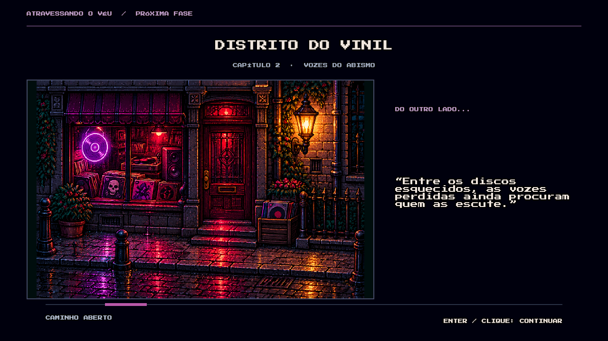
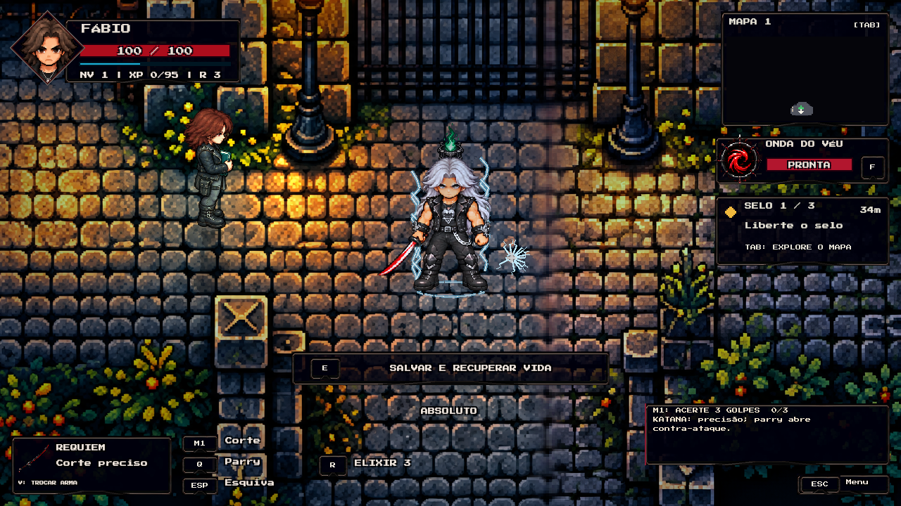
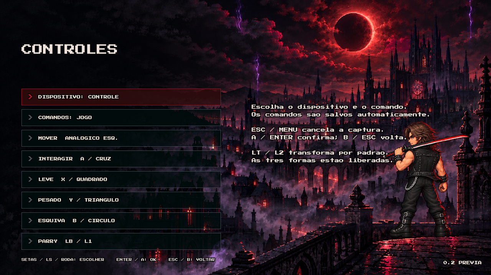

# Remaster — 14/10/2026

Prévia em desenvolvimento de DARKLIGHT: REQUIEM. As formas e auras do protótipo solo foram aprovadas visualmente pelo criador. Esta atualização integra esse trabalho à campanha.

## Personagens e animações

- Envelhecimento removido do jogo atual. Réquiem e Rock mantêm a identidade jovem, sem barba, nas três armas e transformações. Os recursos envelhecidos foram retirados do conteúdo ativo; referências pessoais originais foram preservadas.
- 55 folhas jovens / 1.184 quadros completos no catálogo normal. As animações usam figuras inteiras, sem montagem de cabeças, corpos ou armas separados.
- 165 combinações de folhas transformadas / 3.552 referências a quadros completos. Ataques, caminhada, repouso, defesa, esquiva, dano e queda mantêm as identidades carmesim, violeta e branca. As referências reutilizam somente figuras completas já desenhadas.
- Forma violeta com duas poses de repouso animadas. Rock mantém colete curto, braços expostos, calça e joelheiras, sem abas de sobretudo.
- Eixo horizontal das animações de caminhada e repouso corrigido para reduzir os saltos laterais do corpo. Alinhamento de locomoção dos secundários também corrigido. Pivô vertical, PNGs e identidades dos sprites preservados nessa operação.
- Secundários redesenhados no traço do protagonista: 18 folhas / 144 quadros completos.

## Transformações e combate

As três formas ficam disponíveis desde o primeiro capítulo. T / LT / L2 transforma; Pausa → Transformações escolhe a forma. Custo: 60 de sangue. Cada uso dura pelo menos 180 segundos de ação, mais dois segundos por nível de domínio. Entrada e pausa não consomem esse tempo.

Entrada de 1,8 segundo, com concentração de energia, liberação e mudança gradual da figura; saída de 0,55 segundo. Auras contínuas mais visíveis, com raios na forma branca. Novos rastros da katana, cortes duplos das adagas, elos da corrente e impactos de combate. As partículas e impactos têm limites de quantidade e reutilizam recursos.

## Luz, sombra e apresentação

URP 2D configurado no renderizador e em todos os níveis de qualidade. Luzes do cenário, pontos de interesse e armas participam da apresentação. Sombras projetadas dos personagens respondem às luzes próximas. Quatro opções visuais limitam luzes, sombras, partículas e bloom conforme a qualidade escolhida.

## Controles

Remapeamento por comando e dispositivo, atalhos alternativos, confirmação de conflitos com troca dos comandos envolvidos, cancelamento e restauração de padrões. Há tempo limite para captura e pausa de liberação para evitar registrar o clique que abriu o menu. Esc / Start mantém acesso de emergência à pausa. Os atalhos são persistidos por mapa, ação e posição; configurações antigas são migradas.

Padrão: LT / L2 transforma; RT / R2 usa elixir. O jogador pode trocar essa escolha no remapeamento. Nomes de botões adaptados a Xbox e PlayStation. Não houve validação com controle físico nesta entrega.

## Passagens de fase

Dez ilustrações próprias em pixel art mostram apenas um trecho característico do próximo destino, sem exibir o mapa inteiro. A tela traz o nome da região e um presságio curto, aparece antes da construção da fase e bloqueia comandos de gameplay durante a passagem. Não há porcentagem fictícia. Detalhes em [Loading](LOADING-20261014.md).

## Verificações e limites

Antes do pedido final para interromper os testes: 92 verificações EditMode passaram; quatro verificações de loading, apresentação e continuidade da campanha passaram; duração mínima, repouso violeta e controles tiveram verificações direcionadas aprovadas. O protótipo solo produziu 650 capturas e restaurou o renderizador ao terminar. Essas rodadas ocorreram em revisões específicas e não certificam alterações posteriores.

A rodada ampla seguinte terminou com 85 aprovações e nove falhas, incluindo expectativas antigas de recoloração, duração da transição e posição de opções no menu. Essas expectativas foram atualizadas para as figuras completas e interface atuais. Não foi feita nova rodada após a integração final, por solicitação expressa do criador. Não há certificação de desempenho, campanha manual completa ou controle físico nesta atualização.

Uma verificação identificou gravação do mapa de exploração durante a rodada ampla. Os dois arquivos anteriores foram restaurados byte a byte, mantendo cópias do estado alterado. A gravação recebeu uma proteção específica para o executor de testes. A recuperação comparou os arquivos para não sobrescrever progresso posterior do jogador.

O novo executável, quando listado na entrega, é uma compilação de prévia sem novo playtest após esse pedido. A Alpha 0.1 publicada anteriormente continua sendo uma versão distinta.

## Pendências conhecidas

- Conferência manual da campanha, das transições e do controle físico pelo criador.
- Medição de desempenho do executável final nas opções visuais; não afirmar 60 FPS sem essa medição.
- Revisão visual fina de proporções e alinhamento das poses transformadas de defesa, esquiva e queda recém-integradas.
- Revisar as poses neutras normais de Corrente que ainda podem mostrar uma lâmina rígida na folha de combate; os ataques e a caminhada usam Corrente própria.
- Polimento adicional de cenário, balanceamento e animações conforme feedback da prévia. Esta entrega não é uma edição definitiva finalizada.
